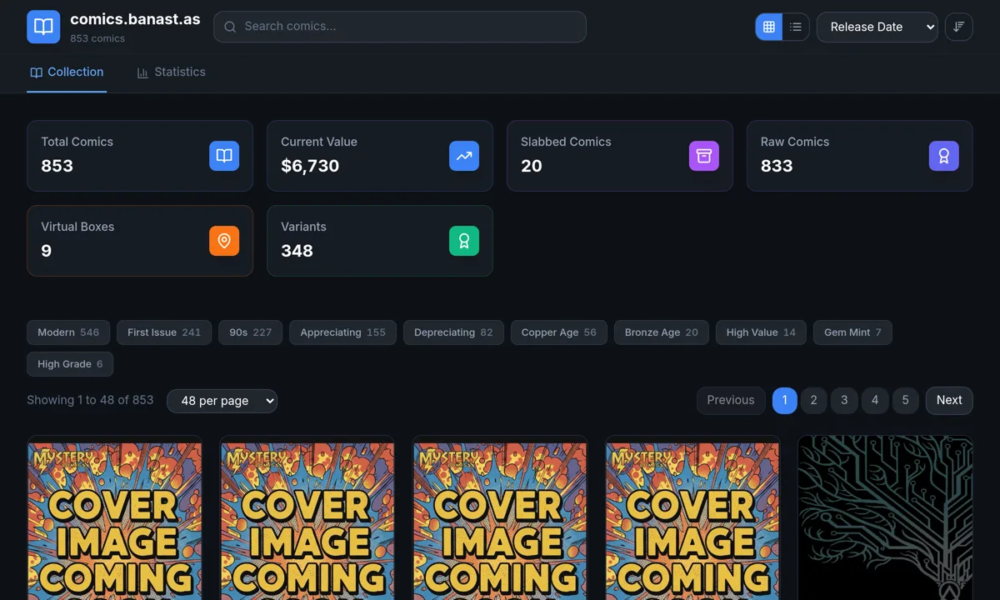

# comics.banast.as

[](https://comics.banast.as)
[](https://github.com/banastas/comics.banast.as/actions/workflows/ci.yml)
[](LICENSE)

A public, responsive catalog for browsing a personal comic-book collection. It combines collection search, storage organization, grading and value analytics, clean shareable routes, and a read-only API in one static Astro site with React for the interactive parts.



_Live collection overview captured September 1, 2026._

## Highlights

- Browse the collection as a cover grid or compact list.
- Search titles, series, artists, notes, and signatures.
- Sort and filter by release date, issue number, grade, price, value, condition, and variant status.
- Explore dedicated pages for comics, series, publishers, cover artists, computed tags, storage boxes, raw comics, slabbed comics, and variants.
- Review acquisition, grade, value, and collection-health analytics.
- Share clean canonical URLs while preserving old hash-route bookmarks.
- Consume the same checked-in collection through read-only Cloudflare Pages Functions.

Visit the production site at [comics.banast.as](https://comics.banast.as).

## How it works

The site is built with [Astro](https://astro.build), TypeScript and Tailwind CSS 4. Every page (the collection, each comic, series, cover artist, tag and storage box, plus statistics) is rendered to HTML at build time with its own title, description, canonical URL, Open Graph and Twitter metadata, and JSON-LD. React hydrates only the parts people interact with: the header search, the collection's search, tag filters, sorting, view and pagination, detail-list sorting and paging, the cover lightbox, and box sorting.

Pages ship their first screen of comics in the HTML. The whole collection is published as `/data/comics.json`, which the browser fetches only when a reader searches, filters, sorts or pages past what was rendered. Zod validates collection records, and Vitest covers data contracts, the interactive islands, routing, structured data, accessibility guardrails, the API, and the public surface.

`src/data/comics.json` is the shared source for every page, the sitemap, the data file, and the API (`functions/api/`, Cloudflare Pages Functions). A collection update therefore requires a validated build and deployment.

## Quick start

Requirements:

- Node.js 22.23.4 or newer, with Node.js 24 LTS recommended
- npm 11

```bash
git clone https://github.com/banastas/comics.banast.as.git
cd comics.banast.as
npm ci
npm run dev
```

Open [http://localhost:4321](http://localhost:4321).

To start with the small demonstration dataset instead of the public collection:

```bash
cp example-comic-collection.json src/data/comics.json
npm run dev
```

## Commands

| Command | Purpose |
| --- | --- |
| `npm run dev` | Start the Astro development server. |
| `npm run check` | Run the complete release gate. |
| `npm run validate:data` | Validate the collection JSON contract and print non-failing data quality warnings. |
| `npm run typecheck` | Run `astro check` and typecheck the Cloudflare Functions and the sync script. |
| `npm run lint` | Run ESLint across the repository. |
| `npm run test:run` | Run the Vitest suite once. |
| `npm run build` | Build the static site into `dist/`. |
| `npm run verify:dist` | Verify every sitemap URL, its metadata and assets, the 404 page, the data file, and the CSP hashes in `dist/`. |
| `npm run preview` | Preview the production build locally. |
| `npm run verify:http -- <origin> [sitemap]` | Crawl a running Cloudflare preview or deployed site from a sitemap (by default `dist/sitemap.xml`) and validate the API. |

`npm run check` is the authoritative pre-merge and pre-deploy command. The sitemap is generated by the build (`src/pages/sitemap.xml.ts`) from the same route data as the pages, so it can never drift from them.

## Repository map

```text
src/
├── pages/               One Astro route per page type, plus the sitemap and /data/comics.json
├── layouts/             The HTML document: head metadata, analytics, header, footer
├── islands/             React components hydrated in the browser (collection page, header)
├── components/          React views rendered at build time or hydrated as islands
├── data/                comics.json (canonical collection) and series.json
├── styles/global.css    Tailwind 4 theme and base styles
├── types/Comic.ts       Shared collection types
├── utils/               Route data, page metadata, slugs, filters, stats, structured data
└── validation/          Zod collection schema
functions/api/           Read-only Cloudflare Pages API
integrations/            Post-build step: decoded file names and CSP script hashes
scripts/                 Data validation, build and HTTP verification
scripts/sync/            Google Sheet → comics.json sync
public/                  Icons, manifest, _headers and robots.txt
docs/                    Architecture notes and repository images
```

## Data contract

Each collection record follows the `Comic` interface in `src/types/Comic.ts`. Before committing synced or hand-edited data, run:

```bash
npm run check
```

The checks reject malformed records, duplicate IDs, duplicate public slugs, sitemap and static-page drift, missing public assets, and API incompatibilities. `npm run validate:data` also prints a non-failing WARNINGS section with record IDs for data to fix in the source app, such as purchase dates before release dates, inconsistent series or artist spellings, raw 9.8+ grades, records without any price, and placeholder covers. Do not commit credentials or private collection data. Cover images are referenced by URL and are not copied into this repository.

Records may also carry `slug` (the permalink, frozen when the comic is first synced so later renames never change its URL), `issueLabel` (shown instead of `#<issueNumber>`, e.g. "Annual 1"), and `valueAsOf` (the date `currentValue` last changed, shown as "as of …" on the comic page). The sync fills these in; add optional `issueLabel` and `valueAsOf` columns to the sheet's `comics` tab to set them directly.

`src/data/series.json` holds optional per-series details keyed by the exact `seriesName`: `publisher`, `volume` and `startYear`. The sync writes it from the sheet's optional `series` tab (see below). Series pages show them under the title ("Marvel · Volume 1 · Since 2021"), comic pages show the publisher, and both add them to their JSON-LD. Each publisher gets a page (`/publisher/Marvel`) listing its comics and series, linked from series and comic pages and from the Publishers panel on the statistics page. Validation rejects names that are not in the collection.

The root `example-comic-collection.json` provides a small self-hosting example without replacing the live collection contract.

## Collection sync

The collection is edited in a Google Sheet (tab `comics`) and synced into `src/data/comics.json` by `scripts/sync/sync-comics.ts`. The [Sync comics from sheet](.github/workflows/sync-comics.yml) workflow runs it nightly at 07:15 UTC and on demand from the Actions tab (**Run workflow**, optionally as a dry run). When the sheet changed, the workflow runs `npm run check` and commits the data as `data: sync comics from sheet (N total, +added / -removed / ~updated)`; when nothing changed it commits nothing.

The sync:

- keeps each comic's ID from the sheet's `id` column, gives rows without one (blank, `TRUE` or `FALSE`) the next `comic-N`, and writes those IDs back to the sheet before saving, so a retried run never duplicates comics;
- keeps the previous release date, purchase date and grade when the sheet leaves them blank, and changes `updatedAt` only for rows that changed;
- refuses to publish if the sheet has more than 10% fewer comics than `comics.json`, or has duplicate or malformed IDs, and names the sheet row of any value the site schema rejects;
- reads an optional `series` tab with the columns `seriesName`, `publisher`, `volume` and `startYear` into `src/data/series.json`. `seriesName` must match the comics tab exactly; blank cells are left out, unknown series are skipped with a warning, and duplicate rows or non-numeric volumes and years fail the run. Without the tab, `series.json` is left as it is.

Setup, once:

1. In Google Cloud, create a service account, enable the Google Sheets API for its project, and create a JSON key.
2. Share the sheet with the service account's email as an **Editor** (it writes new IDs back).
3. Add the key JSON as the repository secret `GOOGLE_SERVICE_ACCOUNT_JSON`.
4. If `main` is protected, allow GitHub Actions to push to it.

To preview a sync locally:

```bash
GOOGLE_SERVICE_ACCOUNT_JSON="$(cat path/to/key.json)" node scripts/sync/sync-comics.ts --dry-run
```

## Public API

Cloudflare Pages Functions expose read-only JSON endpoints:

- `GET /api/comics`
- `GET /api/comics?series=Alien`
- `GET /api/comics?artist=Jock`
- `GET /api/comics?q=signature`
- `GET /api/comics?limit=50&offset=100`
- `GET /api/comics/stats`
- `HEAD` and `OPTIONS` on both endpoints

The collection endpoint supports series, artist, and text-query filters, plus optional `limit` (1–1000) and `offset` pagination applied after filtering. Responses include `count` (records in this response), `total` (matching records), `offset`, `limit`, and `comics`; without pagination parameters every matching record is returned. Each comic also carries its permalink `slug` and `url`, plus `issueLabel` and `valueAsOf` (both `null` when not set). Invalid parameters return a JSON 400, and other methods return 405. Both endpoints return CORS, security, and short-lived cache headers for read-only clients.

## Cover thumbnails

Covers live full size on `covers.banast.as`. Cloudflare Image Transformations is enabled for the banast.as zone, so pages request resized AVIF/WebP covers through `https://covers.banast.as/cdn-cgi/image/…` at two widths (240 and 480 px) with `srcset`; a typical grid cover drops from about 160 KB to about 11 KB. Two widths keep roughly 900 covers inside the free tier's 5,000 unique transformations a month. If a resized image fails, the page falls back to the original file. Build with `PUBLIC_COVER_RESIZE=off` to serve the original files everywhere.

## Routes and SEO

Canonical routes include:

- `/collection` and `/stats`
- `/comic/:slug`
- `/series/:slug`
- `/artist/:slug`
- `/publisher/:slug`
- `/tag/:slug`
- `/storage/:slug` and `/boxes`
- `/raw`, `/slabbed`, and `/variants`

Legacy `/#/...` links are sent to the matching clean route. The build renders a page and sitemap entry for every public route, and `npm run verify:dist` checks that each has matching canonical, social and structured metadata. Each comic keeps the slug it was first published with, so renames never change its URL. `/collection` renders the same view as `/`, so its page declares `https://comics.banast.as/` as canonical and the sitemap lists only `/`.

See [SEO.md](SEO.md) for the rendering contract and [docs/ssr-migration-prd.md](docs/ssr-migration-prd.md) for the migration history.

## Deployment

```bash
npm run check
```

For release QA, start Cloudflare's local Pages runtime with the built assets and Functions, then run the HTTP gate against that preview:

```bash
npx wrangler pages dev dist --port 5198 --compatibility-date 2026-07-17
# In a second terminal:
npm run verify:http -- http://127.0.0.1:5198
```

The HTTP gate catches asset-path and redirect failures that file-existence checks cannot detect. To prove a new build serves every URL the live site already publishes, pass the production sitemap: `npm run verify:http -- http://127.0.0.1:5198 https://comics.banast.as/sitemap.xml`. After an authorized deployment, run it again with `https://comics.banast.as` as the origin.

Cloudflare Pages builds with `npm run build` and serves `dist/` together with `functions/`; the build needs Node.js 22.23.4 or newer (set `NODE_VERSION` in the Pages project if its default is older). No application environment variables are required. `public/_headers` supplies security and cache headers; the build fills in the hashes of every inline script in its Content-Security-Policy. `404.html` makes unknown routes return a real 404.

## Browsing and statistics

On the collection page, search, view, sort, computed-tag filters and the page number live in the URL, so any view can be shared or bookmarked; the header search on other pages submits to the collection. Detail lists show 48 comics per page, and list pagination is available above and below the results. Missing purchase prices display as unrecorded; returns and series performance use only comics with both a recorded purchase price and a current value. The dashboard states that coverage explicitly.

The latest full QA findings and verification evidence are in [docs/qa-2026-10-17.md](docs/qa-2026-10-17.md).

## Contributing and security

Contributions are welcome. Read [CONTRIBUTING.md](CONTRIBUTING.md) before opening a pull request. Report vulnerabilities through the process in [.github/SECURITY.md](.github/SECURITY.md).

## License

[MIT](LICENSE)
